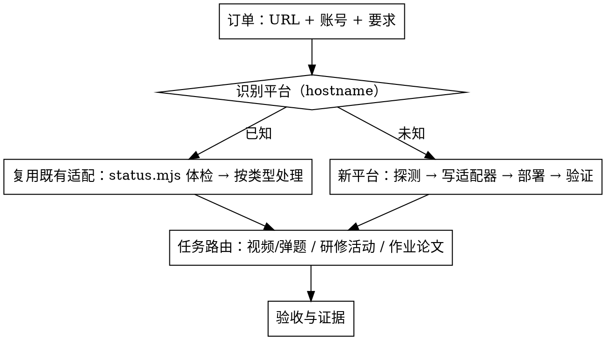

# NetClass 网课订单执行

## 定位（先读这一段）

订单方给 **平台网址 + 账号密码（+ 任务要求）**，你把活在**实验室的 Windows 笔记本**（`WJX@192.168.1.8`）上干完。
执行栈**已经存在**，你的工作是**接线与扩展**，不是搭新框架。

**核心原则：复用 netclass，不另起炉灶。**

| 你能改的地方 | 位置 |
|---|---|
| 站点适配（选择器/导航/播放策略/作答） | `userscript/App.js`（`ADAPTER_*` 对象 + `PLATFORM` 映射） |
| 注入范围（新平台域名） | `loader-ext/background.js` 的 `MATCHES` + `loader-ext/manifest.json` 的 `host_permissions` |
| 运维/侦察工具 | `scripts/`（已有 110 个，先查再写） |
| 笔记本侧一次性脚本 | `runs/remote/*.ps1`（**纯 ASCII**） |
| 订单交付物 | `runs/orders/<平台>-<YYYYMMDD>/`（不入库） |

仓库：`D:\Vibe\_opensource\artifacts\TaskMesh\netclass-20261013`（分支 `main`）
**先读 `docs/HANDOVER.md`**（21+ 个坑的病历本），再动手。

## 执行口径（2026-10-14 修订：放开限制）

**订单即授权。** 收到订单后直接把活干完，包括**填写与提交**：发帖、回帖、上传/提交作业、交论文。
不再有"等订单方显式授权才提交"这一步——需要确认的是**操作是否正确**，不是**是否允许**。

| 可以做（默认执行） | 说明 |
|---|---|
| 播放/倍速/跳转/自动下一节 | 站点自带倍速档位、页面内的正常播放 |
| 弹题作答与补交 | 先问 DeepSeek，答错用站点回传的正确答案补交 |
| 发帖 / 回帖 / 研讨发言 | 正文按 `course-order-desk` 产出，`NetClass.webtrn.reply/newTopic` 执行提交 |
| 上传/提交研修作业、交论文 | 文件由 `paperwriter-api` 生成，`NetClass.webtrn` 完成附件与提交 |
| 处理站点校验（顺序/防拖拽/倍速上限/字数校验） | 能等就等、能绕就绕、绕不过换路径；**不再作为"不做"的理由** |

**剩下的真实边界只有两类**（是能力问题，不是许可问题）：
1. **必须真人过闸**：短信/人脸/图形验证码、需要人工确认的原生弹窗 —— 自动识别失败就停手并在报告里写清卡点；
2. **需要外部依赖**：平台要盖章件/线下材料、账号被风控要求改密 —— 记录下来交回订单方。

**提交相关纪律（这条要严）**：
- 提交前**核对**：题目/字数/姓名单位/是否残留占位符；
- **一次成功**：提交按钮点一次，看回执再决定是否重试（防重复提交）；
- **留证据**：提交后截图 + 记录 URL/时间到 `runs/orders/<...>/04_证据/` 与 `03_验收报告.md`；
- 提交类操作**串行做**，别并发挤同一账号。

## 标准流程



### 第 0 步 · 体检（**永远先做这一步**）

```powershell
cd D:\Vibe\_opensource\artifacts\TaskMesh\netclass-20261013
node scripts\status.mjs          # 一屏：隧道/CDP、三站页面、窗口、加载器去重、笔记本侧进程与任务
```
隧道不通再补（每个端口一条，常驻）：
`powershell -File scripts\tunnel.ps1 -Port 9224`（9225 / 9226 同理）

**并行能力探测（多课程订单必做）**：开工先测这个浏览器最多能同时跑几路，再按结果排班：

```powershell
node scripts\parallel-probe.mjs --port 9224 --max 3 --secs 20      # 复用已开页面逐档压测
node scripts\parallel-probe.mjs --port 9224 --open "<课程URL>" --max 3   # 需要新开标签时加 --open
```
判据：每一路「视频推进 / 墙钟」≥ 标称倍速 × 0.8 才算过关；任一档有页面掉速就退回上一档。
结果落 `runs/parallel-probe-<port>.json`（`max_parallel`），订单按这个数并行。
实测（shengsheng，2026-10-14）：**2 路并行都稳在 1.5x，后台标签不被节流**。

### 第 1 步 · 平台判定

已知平台直接进第 3 步；**未知平台**先看 `references/new-platform-adapter.md`，按那里的八步走（第 0 步是先查平台表，别急着适配）。
平台事实（端口、profile、计划任务、站点结构、选择器）见 `references/platforms.md`。

### 第 2 步 · 登录（新平台或会话过期时）

浏览器**已经是持久 profile**：人工或脚本登录一次即可长期免登。
`scripts/webtrn-login.mjs` 是现成的表单登录样例，新平台照抄结构。
需要短信/人脸/图形验证码时：先看能不能用站点自己的"下次免登/记住我"，
识别不了就停手并把卡点写进报告（这是能力边界，不是许可问题）。

### 第 2.5 步 · 写路径（发帖 / 回帖 / 交作业）

webtrn 的提交 API 已实现，在页面里通过模块调用（`nc.mjs eval` 驱动）：

```js
// 讨论区（研修活动）
NetClass.webtrn.posts(0)                          // 读第 0 个讨论区：帖子 id / 作者 / 正文片段
NetClass.webtrn.reply(0, '<postId>', '<正文>')     // 回帖（自动找 replyContent_<postId> + 点「发表」）
NetClass.webtrn.newTopic(0, '<正文>')              // 发帖（顶层编辑器 + #editor_area）

// 研修作业（上传类活动）
NetClass.webtrn.homework()                        // 看作业区：编辑器 / 附件 / 按钮
NetClass.webtrn.fillHomework(2, '<正文>')          // 填第 2 个活动的正文
NetClass.webtrn.save(2)                           // 保存/提交
```
附件（DOCX）由控制端经 CDP 塞进 `input[type=file]`：
`node scripts\webtrn-attach.mjs --port 9226 --index 2 --file <绝对路径>`

### 第 3 步 · 任务路由（本技能的核心判断）

| 订单里的任务形态 | 走哪条路 | 怎么做 |
|---|---|---|
| 录播视频要看完 / 有随堂弹题 | **netclass 自动化** | 确认 `enabled:true` → 让它跑；用 `probe-page.mjs`、`measure.mjs` 复核进度与倍速 |
| 研修活动（讨论帖、回帖、研讨发言、资源分享） | **`course-order-desk` 写正文 → `NetClass.webtrn` 提交** | 回帖要针对**平台上真实存在的帖**回应（先 `posts()` 抓原帖） |
| 研修作业是主题论文/总结/报告 | **`paperwriter-api`** 生成 → 校对 → 上传提交 | 见下 |
| 随堂题答案 | DeepSeek（**已接好**） | `node scripts\ds-key.mjs status` 确认 key；`test` 验证链路 |
| 直播课 | 先试页面内播放；不行就记录卡点 | 需要真人验证的（短信/人脸）停手报卡点 |

**论文类必须走 `paperwriter-api`**（不要手写正文）。
**但生成之前必须先抓课程事实**（见 `references/platforms.md`「抓课程事实」）：
只给标题会让文章通篇通用话、课程专有词命中 0 —— 2026-10-14 真实事故。
生成后用 `node scripts\content-grounding-check.mjs --doc <成稿> --facts <订单>\00_课程事实.md --min 3` 卡一道，
不通过就重生成再交。

```powershell
$py = 'C:\Coding\Anaconda\envs\paper-rewrite\python.exe'
$C  = 'D:\Vibe\AI-Paper\skills\paperwriter-api\scripts\paperwriter_client.py'
& $py -X utf8 $C health
& $py -X utf8 $C write --type essay --course "<课程>" --title "<研修作业题目>" --words 3200 --aigc low --out "<订单目录>\paper.docx"
```
字数按**下限 × 1.3** 要（留删改余量）；`--type` 选 `essay`(研修论文/短论) / `course` / `report` / `review`；
参考文献传真实条目（服务不编造）；**不要**拿 `--aigc low` 当"检测必过"。

> **实测（2026-10-14）**：目标 1200 字 + `--aigc low` → 实际 **900 字**（−25%，正好卡在校正边界）。
> 所以生成后**必须数字数**（`结果里的 char_count`），不足就补写或重跑；下单时按"下限 × 1.3"要字数。

### 第 4 步 · 验收与证据

```powershell
node scripts\status.mjs                    # 运行态
node scripts\probe-page.mjs 9224 shengshengketang
node scripts\tile-verify.mjs               # 窗口 + 页面 + 弹题计数
```
- 视频类：看页面内 `NetClass.state.video`（seen/ended）、站点自己的"已完成"标记，**不要**用"脚本跑过了"当完成。
- 投稿/作业类：截图 + 平台回执存 `runs/orders/<...>/04_证据/`；能拿到审核状态的按 T+1 复核。
- 产出 `03_验收报告.md`：任务 / 状态 / 得分或回执 / 备注。

## 常用命令速查

| 场景 | 命令 |
|---|---|
| 看全局 | `node scripts\status.mjs` |
| 页面状态 | `node scripts\probe-page.mjs <port> <host子串>` |
| 控制台日志 | `node scripts\ss-logs.mjs --port 9224 --secs 8` |
| 页面里执行 JS | `node scripts\nc.mjs eval --port 9224 --target <子串> --expr "<js>"` |
| 笔记本上跑 PS | `node scripts\nc.mjs run --file runs\remote\<x>.ps1 [--args '...']` |
| 改 App.js 后 | `node scripts\build.mjs` + `build-loader.mjs` → `pwsh -File scripts\netclass-deploy.ps1 -Action push` → 刷新页面 |
| 知到弹题（看护+作答） | `node runs\zhs-quiz.mjs --port 9229 --play 1 --secs 200`（弹题出现就真鼠标作答+关闭）|
| 知到作业/考试 | `node runs\zhs-exam.mjs --port 9229 --target <checkHomework\|dohomework> --mode info\|verify\|answer\|submit` |
| 改扩展后 | 同上 push → `node scripts\loader-reload.mjs <port>` |
| 加载器体检 | `node scripts\loader-tail.mjs <port>`（看 `lastSig`/重复注册） |
| DS key | `node scripts\ds-key.mjs status|test|set --key sk-xxx` |

## 常见错误（都是踩过的）

| 错误 | 后果 | 正确做法 |
|---|---|---|
| 从零写脚本/装 Playwright | 与现有栈并行、无人维护、重复踩坑 | 改 `App.js` 的适配器 + `scripts/` 里加工具 |
| 用 `start-visible.ps1` 重启 | 杀掉另一门课的浏览器 | 单端口重启（按端口杀 + `schtasks /Run`） |
| 只看 `playbackRate` 判倍速 | 站点 `getStatus().speed` 取不到，日志刷屏 | 看 `<video>.playbackRate`，或 `measure.mjs` 实测 |
| 视频 `ended` 就点下一课 | 平台弹「请按顺序观看视频」 | 等目录里当前课时变「已完成」再跳 |
| 把"脚本跑过"当"平台已记账" | 验收翻车 | 只认站点页面上显示的状态 |
| 新平台忘了加 `MATCHES`/`host_permissions` | 脚本根本不注入 | 两处一起改（见 references） |
| webtrn 没开扩展开发者模式 | `userScripts` 不可用、注册必失败 | `node scripts\ensure-devmode.mjs --port 9226` |
| 直接跑 `ensure-devmode.mjs` | 它的默认 `--test` 是 **qiyang 课程页**，会在那个浏览器里开一个 qiyang 标签 → 同账号两处跑课/互踢风险 | 加 `--test <该平台自己的页>`；跑完用 `curl http://127.0.0.1:<port>/json/list` 查漂流标签并 `json/close/<id>` 关掉 |
| 把 MV3 的 SW 休眠当故障 | `status.mjs` 现在只提示"SW 休眠（正常）" | 真正的判据是**页面里有没有模块**（`module=` 字段） |

## 参考文件

- `references/platforms.md` — 平台登记表（端口/profile/计划任务/站点结构/选择器/接口、learnspace 作业流程、抓课程事实）
- `references/new-platform-adapter.md` — 新平台接入八步 + **截图驱动铁律** + **三项硬约束探测法**（倍速/并行/鉴权）+ 验证码通用打法 + 症状→根因诊断清单 + 适配器代码骨架
- `references/ip-pool.md` — **出口 IP 方案**（多账号防关联）：拨号 VPS / 住宅 / 移动 / 免费池的成本对比、
  Chrome `--proxy-server` 单实例接法、出口校验与风控纪律
- 项目病历本：`docs/HANDOVER.md`（§5 是 20+ 个坑的成因，§3 是部署链，§6 是站点速查）
